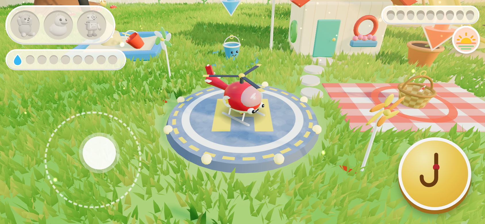
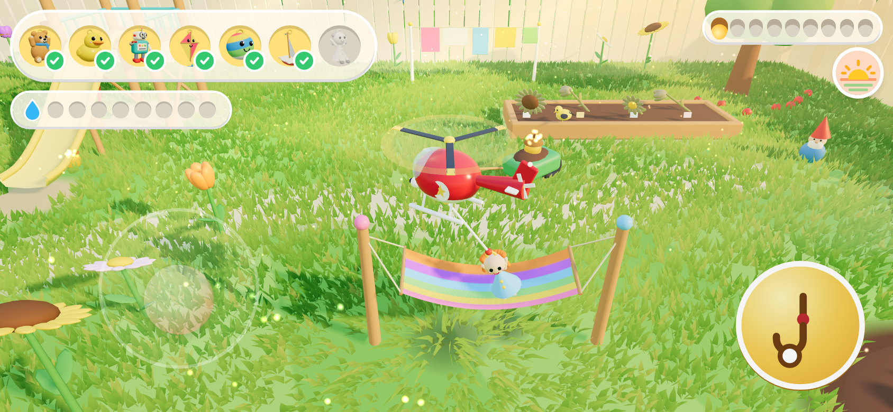
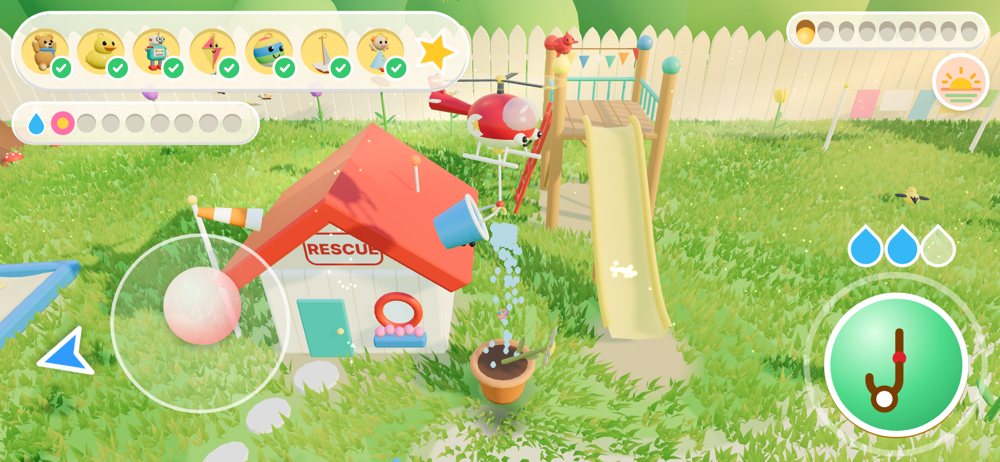
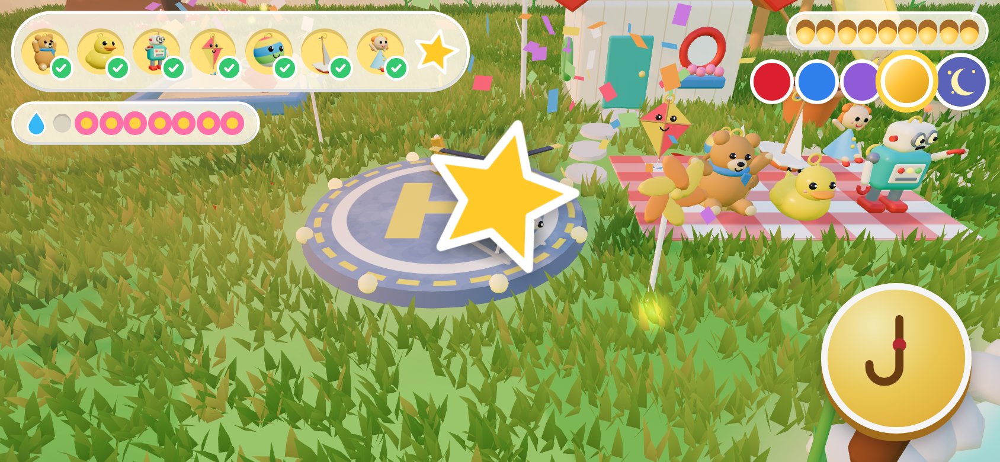

# Backyard Air Rescue

A gentle, wordless 3D game for small kids. Fly a tiny cherry-red rescue helicopter around an
oversized backyard and winch stranded toys back to the landing pad. No crashes, timers, fuel or
reading. The winch takes some skill: line the hook up yourself, and keep holding the button all the
way home or the toy drops.

What there is to do, roughly in the order a child meets it:

1. **Round one:** a teddy in the flower bed, a rubber duck on the pond, a tin robot on top of the play tower.
2. **Round two** (appears once those are home), each needing a different trick: a kite caught on the
   edge of the apple tree, a bouncy ball on the sloping shed roof, a sailboat drifting round the
   paddling pool (a moving target), and a rag doll in a swinging hammock (wait for her to swing through).
3. **The garden:** hook the bucket, fill it in the pond or paddling pool, and water eight wilting plants until they bloom.
4. **Apple picking:** fly close to the apple tree and the rotor wash shakes the apples down. Hook the
   picnic basket off the blanket, dip it over the fallen apples to scoop them up, and bring all eight
   back to the blanket for the toys' picnic.
5. **Golden acorns:** nine are hidden around the yard (a sparkle gives each away). Fly over one to
   collect it. Every three unlock a new paint job for the helicopter: blue, purple, then gold. Tap a
   colour in the top-right corner to switch.
6. **Sunset:** when the toys, garden and picnic are all done, the sun goes down, fireflies come out,
   and a green arrow asks you to land on the pad. Hover over it and the helicopter lands itself.

**Time of day:** tap the sun button in the top-right corner to switch between a warm **morning**
(low golden sun, morning haze and light beams, pollen drifting in the air, lots of butterflies
visiting the flowers, birds hopping on the lawn and singing), the original **afternoon**, and
**evening** (golden light, fireflies, crickets; the butterflies and birds go home). Birds flutter off
when the helicopter comes close and land somewhere else; now and then a little flock flies over.

Progress (rescues, garden, picnic, acorns, paint, time of day) is saved on the phone. **Grown-ups:** hold the toy
counter in the top-left corner for three seconds to start over.






Clip of the winch: [`media/winch-teddy.mp4`](media/winch-teddy.mp4)

## Install on an Android phone or tablet

1. Copy [`dist/BackyardAirRescue.apk`](dist/BackyardAirRescue.apk) to the device (or download it there).
2. Open it and allow "install unknown apps" for the app you opened it with.
3. Launch **Backyard Air Rescue**. It runs full-screen in landscape and never uses the network
   (the app does not even request the internet permission).

Needs Android 7.0+ with a reasonably current Android System WebView / Chrome (WebGL).
The APK is debug-signed: fine for sideloading, not for the Play Store.

## How it plays

| | |
|---|---|
| Drag anywhere on the left side | A floating joystick appears under the thumb. The helicopter leans first, then goes; let go and it brakes into a hover. |
| Hold the big yellow button | The hook goes down while you hold it and reels back up when you let go. It only clicks onto a toy if it reaches the toy's loop lined up and not swinging; the ring under the toy turns green when the hook is right above it. If it is a little off, the hook bumps the toy's head with a "tink". |
| Keep holding all the way home | Let go before the toy is over the pad and it drops (softly; go hook it again). Let go over the pad, when the button turns green, and it is set down and counted. In free flight after all three, letting go sets a toy down gently anywhere. |
| The basket | Hook it off the picnic blanket. Over fallen apples it dips to the grass and they hop in; eight red dots by the button count them. Let go away from the blanket and the apples spill out. |
| The bucket | Hook it like a toy (it waits beside the rescue shed). Carry it over the pond or paddling pool and it dips in and fills: three drops by the button show how much is left. Hover it over a wilting plant and it tips and pours; one drop per plant. Let go and it falls and spills. When the whole garden is in bloom there is a celebration, and later plants get thirsty again one at a time. |
| Bouncing arrows | Orange = a toy to rescue, green = bring it here, blue = bucket, water or a thirsty plant, red = basket, apple tree or fallen apples. An arrow at the screen edge points to the next one when it is out of view. |

## Build it yourself

```sh
npm install
npm run build          # bundles src/ + three.js into www/ (open www/index.html in a browser to play; WASD/arrows + space)
npm run apk            # www/ -> dist/BackyardAirRescue.apk   (needs JDK 17+ and ANDROID_SDK_ROOT with platforms;android-34 + build-tools;34.0.0)
npm run playtest       # automated phone-size run-through (needs Playwright + Chromium)
node tools/capture.mjs # re-records media/winch-teddy.mp4 from real gameplay
```

- `src/main.js` – flight model, winch + cable physics, camera, HUD (tuning constants at the top)
- `src/world.js` – the yard: tree, pond, slide, shed, pad, flowers, grass
- `src/models.js` – helicopter and the three toys
- `src/picnic.js` – picnic basket, apples, the hammock
- `src/garden.js` – east garden, thirsty plants, paddling pool, the bucket
- `src/birds.js` – birds on the lawn, fence and roofs, and the passing flock
- `src/life.js` – leaves, beach ball, pinwheels, butterflies, confetti
- `src/audio.js` – all sound is synthesised at runtime (no audio files)
- `android/` – a ~60-line full-screen WebView shell and a Gradle-free build script

Everything is generated in code: there are no downloaded models, textures or sounds.
