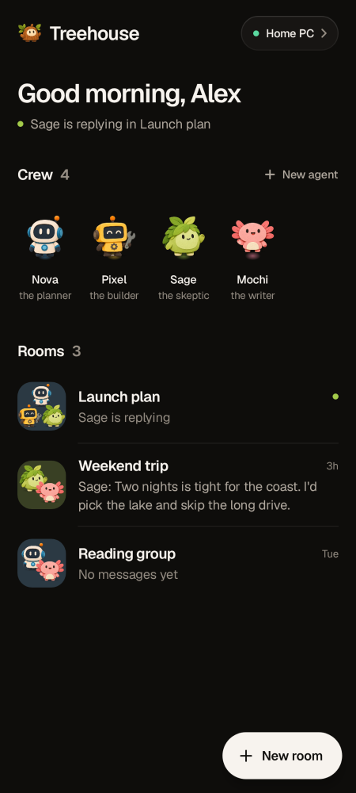

# Orbit

An Android app for running a crew of AI agents that work together, paired to a
hub on an always-on PC.

<p>
  
  
  
</p>

- **Agents** each have their own avatar, model, provider, and instructions.
- **Rooms** are group chats. In a *round table* every agent replies in turn; in
  a *lead* room one agent answers first, delegates, and sums up. Agents hand
  work to each other with `@Name`, and you can `@mention` to ask one directly.
- **The hub** (`hub/`) runs on your PC. It holds the API keys, calls the
  models, and keeps agents working while the phone is asleep. The app
  (`android/`) is a client for it.

## 1. Start the hub on your PC

Install [Node.js](https://nodejs.org) (the LTS version), then double-click
**`hub/Start Orbit.bat`**. The first time it:

- downloads what the hub needs (a minute),
- asks Windows for permission, once, to let your phone through the firewall,
- opens a pairing page in your browser with a QR code, and
- offers to start the hub automatically whenever you sign in to Windows.

Keep its window open while you use Orbit. On a Mac or Linux, run `npm start` in `hub/`.

If you skipped a step, you can redo it from the `hub` folder:
`npm run firewall` (allow phones through Windows Firewall), `npm run autostart:on`
or `npm run autostart:off`.

## 2. Pair your phone

Install the app, tap **Scan QR code** and scan the code on the pairing page (or in
the hub's window). If scanning isn't available, tap **Find** or type the address
and six-digit code shown under the QR code. The code changes after each pairing.

The phone talks to the hub over plain HTTP, so keep it on your home network.
To reach the hub from elsewhere, put both devices on a private VPN such as
Tailscale and use the PC's VPN address.

## 3. Add an AI key

In the app, open **Settings** (tap your PC's name on the home screen), tap a
provider and paste its key. The hub checks the key with the provider, then stores
it only on your PC, in `~/.orbit-hub/config.json`. Until a key is added, agents
run on a built-in demo provider.

Keys can also come from `ANTHROPIC_API_KEY`, `OPENAI_API_KEY`, `XAI_API_KEY`,
`GEMINI_API_KEY` and `OPENROUTER_API_KEY`. In `config.json`, any extra provider
entry with a `baseUrl` is treated as an OpenAI-compatible server, e.g.
`"my-server": { "label": "My server", "baseUrl": "http://localhost:1234/v1" }`.

## 4. Build the app

Needs JDK 17+ and the Android SDK (platform 37.2).

```
cd orbit/android
./gradlew :app:assembleDebug        # app/build/outputs/apk/debug/app-debug.apk
./gradlew :app:assembleRelease      # signed, if a release key is set up (below)
```

### Release signing

Releases are signed with one key, kept out of the repository, so each new version
installs over the last. Builds read it from `android/keystore.properties`
(ignored by git):

```
storeFile=/path/to/orbit-release.jks
storePassword=...
keyAlias=orbit
keyPassword=...
```

or from the environment variables `ORBIT_KEYSTORE_FILE` and `ORBIT_KEYSTORE_PASSWORD`.
Without either, release builds are left unsigned.

The **Orbit Android release** GitHub workflow builds a signed APK on demand (Actions
tab, Run workflow) and publishes a release when a tag like `orbit-v0.4.0` is pushed.
It needs two repository secrets: `ORBIT_KEYSTORE_BASE64` (the key file, base64) and
`ORBIT_KEYSTORE_PASSWORD`. Bump `versionCode` and `versionName` in
`android/app/build.gradle.kts` for each release.

## Tests

```
cd orbit/hub && npm test                          # pairing, keys, orchestration, event stream
cd orbit/android && ./gradlew :app:testDebugUnitTest
cd orbit/android && ./gradlew :app:recordPaparazziDebug   # re-render screen snapshots and motion recordings
```

Screen snapshots land in `android/app/src/test/snapshots/images`. `MotionTest` records the app's
animations (the orbiting hero, avatar morphing, streaming chat, shared-element navigation) as
animated PNGs in `android/app/src/test/snapshots/videos`, so motion can be reviewed frame by frame
without a device.

`LiveHubTest` drives the real app client against a running hub when
`ORBIT_HUB_URL` and `ORBIT_HUB_CODE` are set; otherwise it is skipped.
