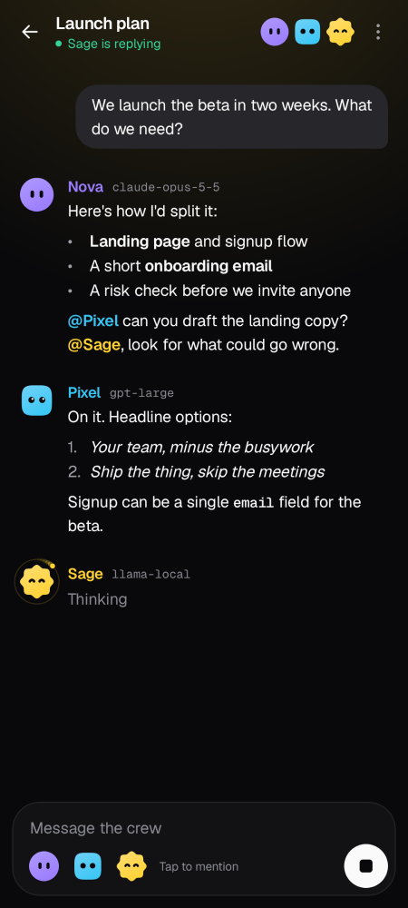

# Orbit

An Android app for running a crew of AI agents that work together, paired to a
hub on an always-on PC.

<p>
  
  
  
</p>

- **Agents** each have their own avatar, model, provider, and instructions.
- **Rooms** are group chats. In a *round table* every agent replies in turn; in
  a *lead* room one agent answers first, delegates, and sums up. Agents hand
  work to each other with `@Name`, and you can `@mention` to ask one directly.
- **The hub** (`hub/`) runs on your PC. It holds the API keys, calls the
  models, and keeps agents working while the phone is asleep. The app
  (`android/`) is a client for it.

## 1. Run the hub on your PC

Needs Node 20 or newer.

```
cd orbit/hub
npm install
npm start
```

It prints the address and a six-digit pairing code. On first run it creates
`~/.orbit-hub/config.json`; add API keys there and restart:

```json
{
  "providers": {
    "anthropic": { "apiKey": "..." },
    "openai": { "apiKey": "..." },
    "xai": { "apiKey": "..." },
    "gemini": { "apiKey": "..." },
    "openrouter": { "apiKey": "..." },
    "ollama": { "baseUrl": "http://localhost:11434/v1" },
    "my-server": { "label": "My server", "baseUrl": "http://localhost:1234/v1" }
  }
}
```

Keys can also come from `ANTHROPIC_API_KEY`, `OPENAI_API_KEY`, `XAI_API_KEY`,
`GEMINI_API_KEY`, and `OPENROUTER_API_KEY`. Any extra entry with a `baseUrl` is
treated as an OpenAI-compatible server. With no keys, the starter crew runs on a
built-in demo provider so you can try the app first.

To keep it always on, start it at login (Task Scheduler on Windows, a systemd
user service on Linux, or `pm2`). The first run may trigger a firewall prompt:
allow Node on private networks (TCP 8787, UDP 8788).

## 2. Pair the phone

Install the app, tap **Find** (or type the address the hub printed), enter the
pairing code, and connect. The code changes after each pairing.

The phone talks to the hub over plain HTTP, so keep it on your home network.
To reach the hub from elsewhere, put both devices on a private VPN such as
Tailscale and use the PC's VPN address.

## 3. Build the app

Needs JDK 17+ and the Android SDK (platform 37.2).

```
cd orbit/android
./gradlew :app:assembleDebug        # app/build/outputs/apk/debug/app-debug.apk
```

## Tests

```
cd orbit/hub && npm test                          # pairing, orchestration, event stream
cd orbit/android && ./gradlew :app:testDebugUnitTest
cd orbit/android && ./gradlew :app:recordPaparazziDebug   # re-render screen snapshots and motion recordings
```

Screen snapshots land in `android/app/src/test/snapshots/images`. `MotionTest` records the app's
animations (the orbiting hero, avatar morphing, streaming chat, shared-element navigation) as
animated PNGs in `android/app/src/test/snapshots/videos`, so motion can be reviewed frame by frame
without a device.

`LiveHubTest` drives the real app client against a running hub when
`ORBIT_HUB_URL` and `ORBIT_HUB_CODE` are set; otherwise it is skipped.
