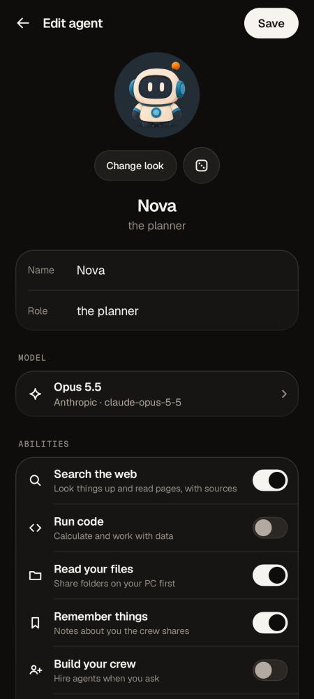

# Orbit

An Android app for running a crew of AI agents that work together, paired to a
hub on an always-on PC.

<p>
  
  
  
</p>

- **Agents** each have their own character (one of 25), model, provider, and instructions. An agent's name and
  @mentions take its character's color.
  Agents on Claude models can also be given **abilities**: search the web,
  run code, read folders you share from your PC, and **build your crew**: ask
  such an agent to create, add or hire someone and it writes their instructions,
  asks which AI model they should use, and picks a character nobody has yet. Your
  guide has it from the start. Their replies show what
  they did ("Searched …", "Read japan.md") and the pages they cite.
- **Rooms** are group chats, with a description every agent in them follows ("We're
  planning a trip to Japan in April. Keep replies short."). In a *best fit* room (the
  default) only the agent or two suited to each message answer it, chosen by a quick,
  cheap model call; speak to the whole group and everyone joins in. In a *round table*
  every agent replies in turn; in a *lead* room one agent answers first, delegates, and
  sums up. Agents hand work to each other with `@Name`, and you can `@mention` to ask
  one directly.
  Long-press a message to copy it, ask the agent again, or delete it. Tap **+** to
  attach photos, PDFs or text files; Claude agents read all three, other models
  see photos where they support them.
- **Share to Orbit** from any app's share menu: a link, some text, photos or
  PDFs. Pick a room and it opens with them ready to send, so you can add a
  question first.
- **Getting to know you.** Orbit starts with one agent, your guide, in a chat
  of its own. It asks a few questions about you, then suggests a crew of two or
  three agents shaped around what you need and, once you agree, creates them and
  a room to work in. (Needs an Anthropic key; you can reopen the chat from
  **Settings, About you**.)
- **Memory.** What your crew knows about you (your name, what you do, how you
  like answers) is shared: every agent sees it in every room, and Claude agents
  add to it as they learn. See and edit it in **Settings, About you**. Each agent
  also keeps its own notes about its work with you. Add them in the agent's
  editor, or, for Claude agents with "Remember things" on, just say "remember
  that…" and the agent saves it itself.
- **Scheduled tasks.** From a room's menu, have the crew run something at a set
  time on chosen days ("Weekdays at 08:15: give me a two-line status"). The hub
  posts it on the PC's clock; the result reaches your phone as a notification,
  usually within 15 minutes.
- **Home-screen widget.** Your newest rooms and the last thing said in each;
  tap one to open it. It stays current through the same background check as
  scheduled results.
- **Notifications.** Leave the app while agents are replying and you get a
  ping when they finish ("Nova: Fuunji is your best bet…"); tap it to open the
  room. The app asks for permission the first time you send a message.
- **Usage.** Settings shows what the crew has cost over the last week, month or
  quarter, per agent and per room, estimated from Claude's published token
  prices. Models without a known price show tokens; add prices for them under
  `"prices"` in `config.json`.
- **Long rooms** stay affordable: past about 15,000 words, the oldest part of a
  room is folded into a running summary that agents read instead.
- **Desktop app.** The hub also serves Orbit for the PC: open
  `http://localhost:8787` in Edge or Chrome and choose **Install Orbit** to keep
  it as an app with its own window. On the PC it signs in by itself; another
  computer on your network can open the hub's address and pair with the code.
- **The hub** (`hub/`) runs on your PC. It holds the API keys, calls the
  models, and keeps agents working while the phone is asleep. The app
  (`android/`) is a client for it.

## 1. Start the hub on your PC

Install [Node.js](https://nodejs.org) (the LTS version), then double-click
**`hub/Start Orbit.bat`**. The first time it:

- downloads what the hub needs (a minute),
- asks Windows for permission, once, to let your phone through the firewall,
- opens the pairing page in your browser (`http://localhost:8787/pair`) with a QR code, and
- offers to start the hub automatically whenever you sign in to Windows.

Keep its window open while you use Orbit. On a Mac or Linux, run `npm start` in `hub/`.

If you skipped a step, you can redo it from the `hub` folder:
`npm run firewall` (allow phones through Windows Firewall), `npm run autostart:on`
or `npm run autostart:off`.

## 2. Pair your phone

Install the app, tap **Scan QR code** and scan the code on the pairing page (or in
the hub's window). If scanning isn't available, tap **Find** or type the address
and six-digit code shown under the QR code. The code changes after each pairing.

The phone talks to the hub over plain HTTP, so it only works on your home
network, or through a private VPN. To use Orbit away from home, install
[Tailscale](https://tailscale.com/download) on the PC and the phone and sign in
to both with the same account. The hub notices its Tailscale address within a
minute and tells the app, which then tries your home network first and
Tailscale when that doesn't answer. **Settings** shows which one is in use.

## 3. Add an AI key

In the app, open **Settings** (tap your PC's name on the home screen), tap a
provider and paste its key. The hub checks the key with the provider, then stores
it only on your PC, in `~/.orbit-hub/config.json`. Until a key is added, agents
run on a built-in demo provider.

Keys can also come from `ANTHROPIC_API_KEY`, `OPENAI_API_KEY`, `XAI_API_KEY`,
`GEMINI_API_KEY` and `OPENROUTER_API_KEY`. In `config.json`, any extra provider
entry with a `baseUrl` is treated as an OpenAI-compatible server, e.g.
`"my-server": { "label": "My server", "baseUrl": "http://localhost:1234/v1" }`.

### A free AI that runs on your PC (optional)

[Ollama](https://ollama.com/download) runs small AI models on the PC itself: free, private, and no key
needed. Install it on the PC and open it. Then in the app, open **Settings**, tap **Ollama (local)** and
tap **Get** next to a model (Llama 3.2 is a good first pick, a 2 GB download). When it finishes, pick it
in an agent's **Model** section. Local models are slower and less capable than Claude, and can't use
abilities (web search, code, folders).

## 4. Share folders with your agents (optional)

On the PC, open `http://localhost:8787/pair` and click **Share a folder…**. Agents
with **Read your files** turned on (in the agent's Abilities) can then list,
read and search the files in it. Access is read only, never reaches outside the
folders you share, and skips hidden files and the hub's own settings. Folders
can only be shared from the PC itself; the app shows them under Settings and
can stop sharing one.

Web search and code run on Anthropic's side and are billed to your Anthropic
account like any other usage.

## 5. Update Orbit

New versions arrive as two files: `orbit-hub-X.Y.Z.zip` for the PC and `orbit-X.Y.Z.apk` for
phones. Save both in the hub's **updates folder** (`C:\Users\<you>\.orbit-hub\updates`;
**Settings, Updates, Open folder** opens it).

- **PC:** an **Orbit X.Y.Z is ready** card appears in the desktop app. Click **Update**: the hub
  checks the package, installs it, restarts and the page reloads. The files it replaced are kept in
  `updates\previous`. Updating restarts the hub, so it asks first if your crew is mid-reply.
- **Phone:** **Orbit X.Y.Z is ready** appears on Home and in Settings. Tap **Update**: the phone
  downloads the app from your PC (at home or through Tailscale) and Android asks you to confirm.
  The first time, Android sends you to a screen to allow Orbit to install updates.

Updates only come from files you saved on your PC. The hub refuses a package that is damaged,
isn't Orbit's, is the same or an older version, or holds anything outside its own `src`, `web` and
`package.json`. `Start Orbit.bat` isn't updated this way; a release that changes it says so.

## 6. Build the app

Needs JDK 17+ and the Android SDK (platform 37.2).

```
cd orbit/android
./gradlew :app:assembleDebug        # app/build/outputs/apk/debug/app-debug.apk
./gradlew :app:assembleRelease      # signed, if a release key is set up (below)
```

### Release signing

Releases are signed with one key, kept out of the repository, so each new version
installs over the last. Builds read it from `android/keystore.properties`
(ignored by git):

```
storeFile=/path/to/orbit-release.jks
storePassword=...
keyAlias=orbit
keyPassword=...
```

or from the environment variables `ORBIT_KEYSTORE_FILE` and `ORBIT_KEYSTORE_PASSWORD`.
Without either, release builds are left unsigned.

The **Orbit Android release** GitHub workflow builds a signed APK on demand (Actions
tab, Run workflow) and publishes a release when a tag like `orbit-v0.4.0` is pushed.
It needs two repository secrets: `ORBIT_KEYSTORE_BASE64` (the key file, base64) and
`ORBIT_KEYSTORE_PASSWORD`.

### Making a release

1. Bump `versionCode` and `versionName` in `android/app/build.gradle.kts`, and `version` in
   `hub/package.json` and `hub/package-lock.json` to the same `X.Y.Z`: the app and hub are released together.
2. `cd hub && npm run package -- <folder>` writes `orbit-hub-X.Y.Z.zip`.
3. `cd android && ./gradlew :app:assembleRelease`, then copy `app-release.apk` to `orbit-X.Y.Z.apk`.
4. Hand over both files to be saved in the updates folder.

## Tests

```
cd orbit/hub && npm test                          # pairing, keys, orchestration, abilities, event stream
cd orbit/android && ./gradlew :app:testDebugUnitTest
cd orbit/android && ./gradlew :app:recordPaparazziDebug   # re-render screen snapshots and motion recordings
```

Screen snapshots land in `android/app/src/test/snapshots/images`. `MotionTest` records the app's
animations (the orbiting hero, characters popping in, streaming chat, shared-element navigation) as
animated PNGs in `android/app/src/test/snapshots/videos`, so motion can be reviewed frame by frame
without a device.

`LiveHubTest` drives the real app client against a running hub when
`ORBIT_HUB_URL` and `ORBIT_HUB_CODE` are set; otherwise it is skipped.
