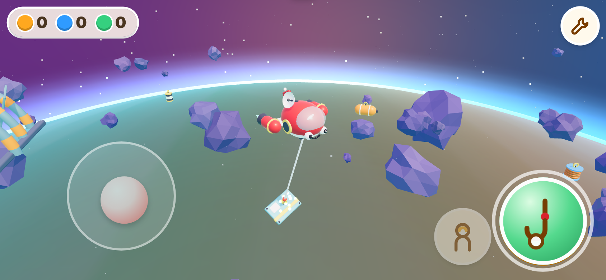
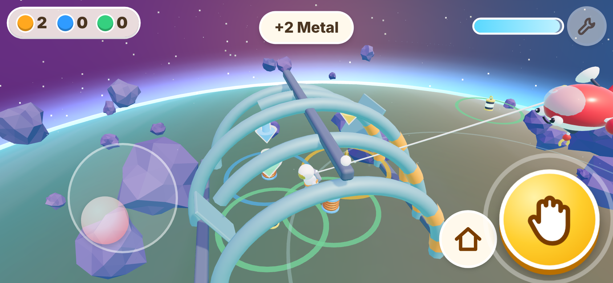
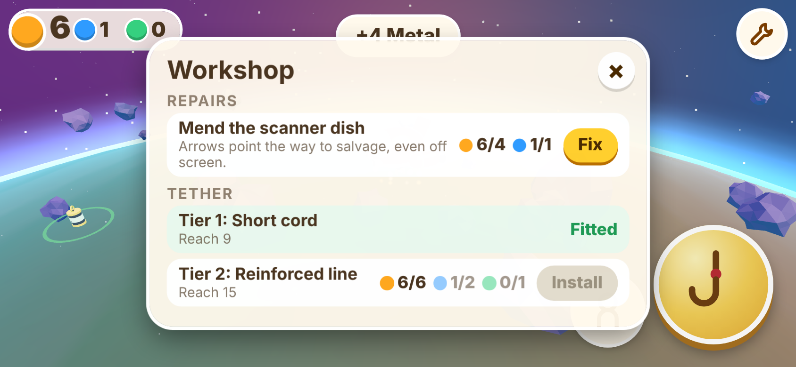

# Starlight Salvage (prototype)

A cozy 3D space salvage game built on the flight and winch model of
[Backyard Air Rescue](../backyard-air-rescue). Fly a little red tug over a debris field, winch
junk into the hold, step outside on a tether for the small pieces, and spend what you find at the
ship's workshop. No fail state, no timers.





## Run it

```sh
npm install
npm run build          # bundles src/ + three.js into www/ ; open www/index.html in a browser
npm run playtest       # automated phone-size run-through (needs Playwright + Chromium)
```

Add `?fresh` to the URL to ignore the save. Hold the cargo counter for three seconds to wipe it.

## How it plays

| | Touch | Keyboard |
|---|---|---|
| Fly / thrust | Drag anywhere on the left side | WASD or arrows |
| Winch (ship) / hand grapple (spacewalk) | Big yellow button | Space |
| Step outside / come home | Small round button beside it | E |
| Workshop | Wrench, top right | Q or Tab |

- **Winch:** hold the button and the hook goes down. Inside an item's ring the hook snaps on by
  itself (the ring turns green). Keep holding to tow it around on the cable; let go and it is
  reeled into the hold and counted.
- **Spacewalk:** the ship holds still. Float to a small item, tap the button to take it in tow
  (up to three). Past the tether ring a gentle pull brings you back; there is no wall. Float back
  to the ship, or tap the home button, to dock and stow what you carried. Oxygen only paces the
  walk: when it runs low the cord shortens, brings you home and refills.
- **The wreck:** the ship is eased around it and cannot go in. Two wire coils, a gear and a power
  cell are inside, so they need a spacewalk.
- **Workshop:** one repair (the scanner dish, which adds arrows and an off-screen pointer to
  salvage) and the tether upgrade. The wrench pulses when you can afford something.
- Collected items drift back into the field after a while, and anything you let go of drifts back
  to where it was.

## Balancing

Everything is in [`src/config.js`](src/config.js): what each kind of junk gives, where the twelve
items float, winch and hand snap radii, spacewalk speed and oxygen, one `radius` per tether tier,
and the cost of each repair and tier.

## Source layout (same as Backyard Air Rescue)

- `src/main.js` – flight model, winch + cable physics, spacewalk + tether, workshop, saving, camera, HUD
- `src/config.js` – all balance data
- `src/world.js` – sky, planet, rocks, the wreck, sparkles
- `src/models.js` – ship, astronaut, the five kinds of salvage, hook, markers
- `src/audio.js` – all sound is synthesised at runtime (no audio files)
- `src/util.js` – shared helpers, copied unchanged
- `tools/` – build script and touch-driving test harness, copied unchanged, plus this game's playtest

## Not in the prototype yet

- Tether tiers 3 and 4 are in `config.js` with their radius and cost, but the reel and the anchor
  points are not built, so the workshop will not install them (`ready: false`).
- The building grid (modular parts) is not started.
- No Android wrapper yet; the helicopter's `android/` folder would work with a new package name.
